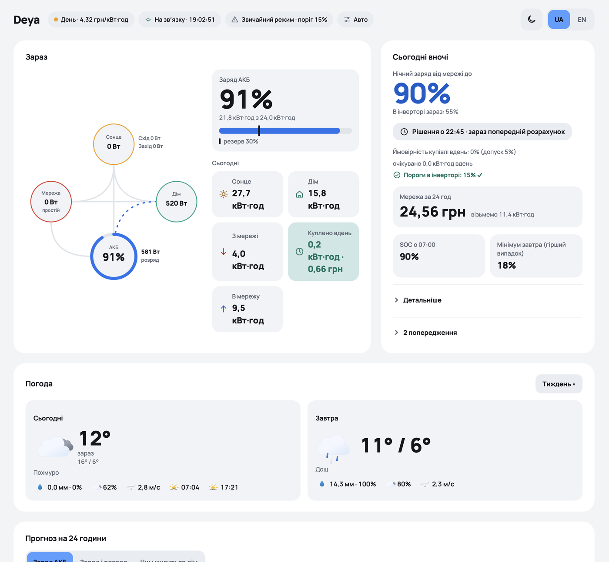
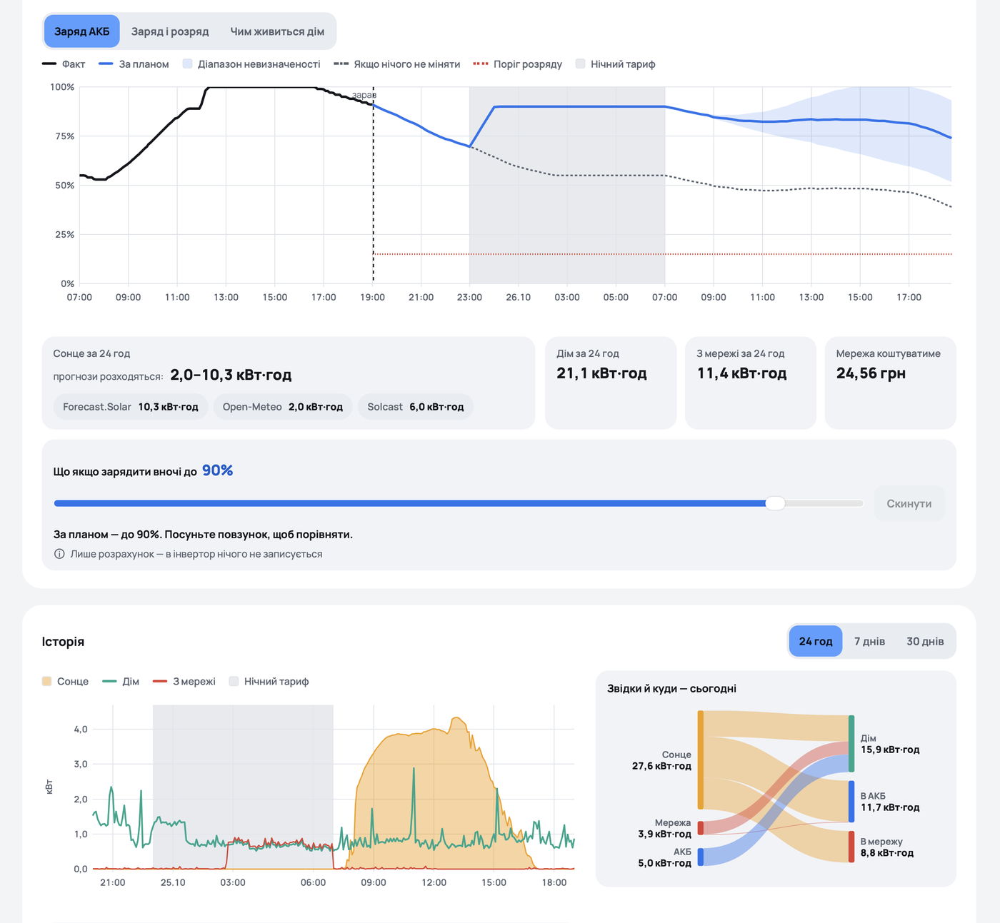
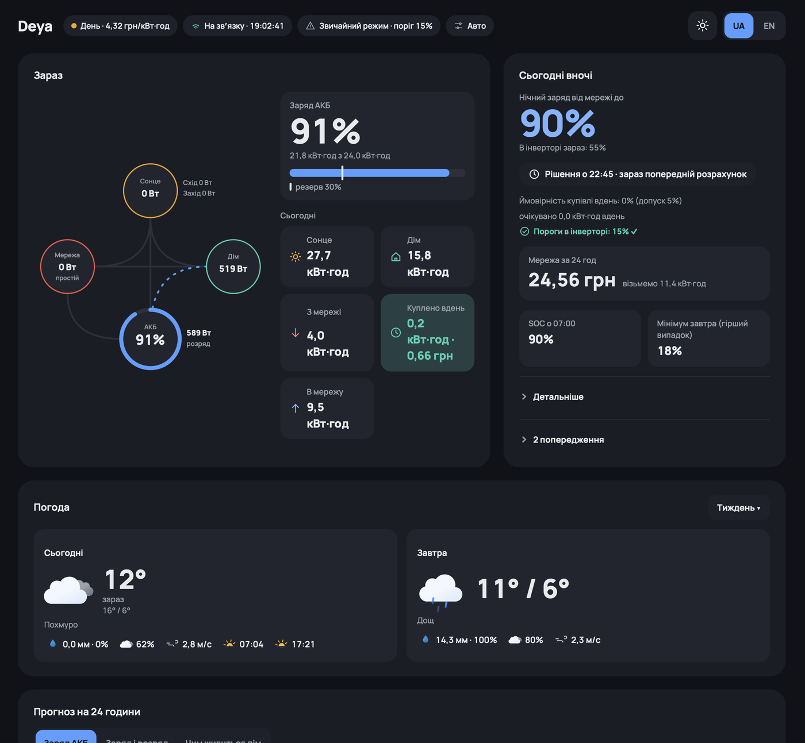
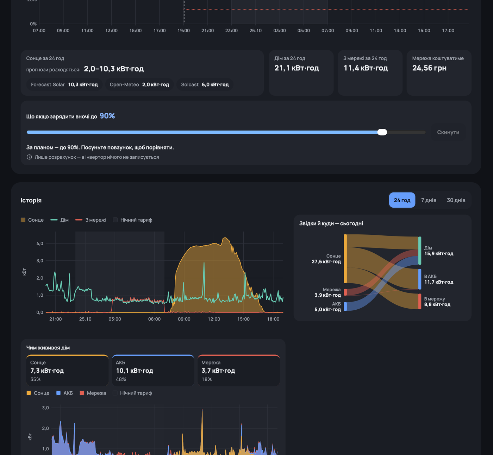
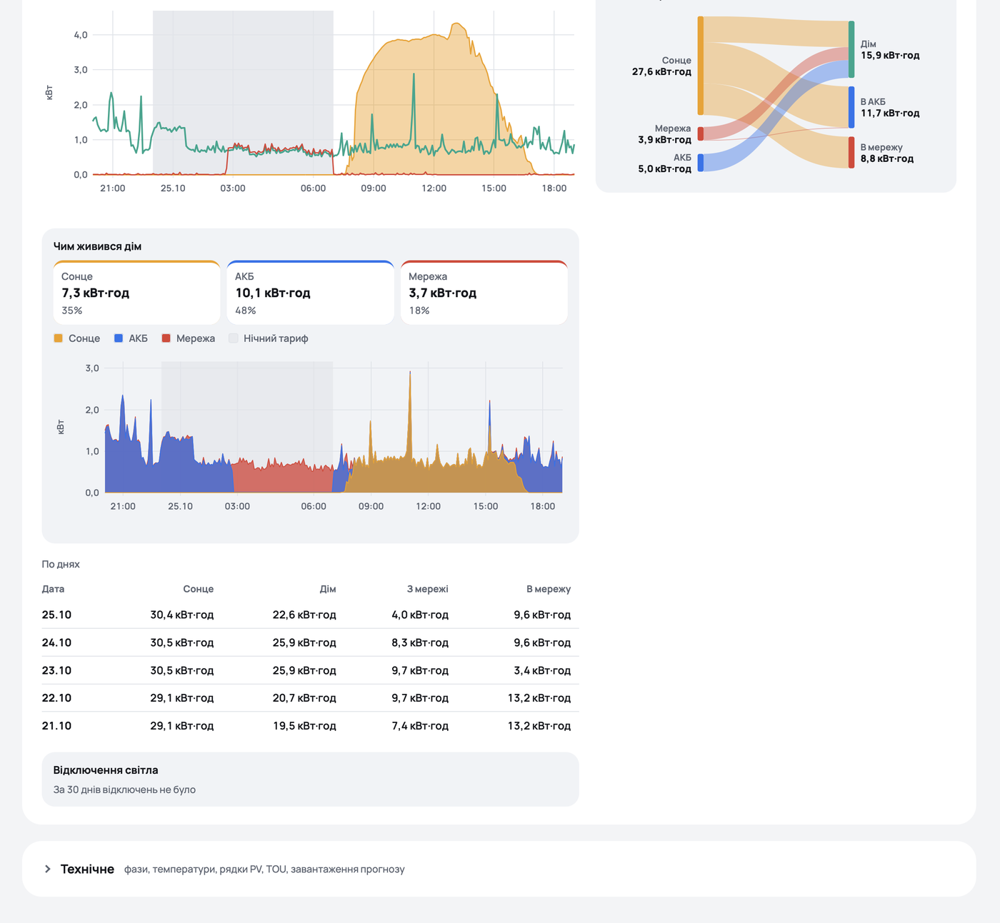

# Deya — monitoring and smart charging for a Deye hybrid inverter

**English** · [Українська](README.uk.md)

Self-hosted web service for a **Deye 3-phase hybrid inverter** (developed on a 12 kW LV model, SUN-*-SG0xLP3)
connected through a **Solarman WiFi logger (LSW3)**. It collects telemetry over the local network, forecasts
solar production and decides every evening how far to charge the battery from the grid at the cheap night tariff,
so that the next day runs on solar as much as possible.

## Screenshots





<details>
<summary>More: dark theme, "what powered the house", daily table</summary>





</details>

## Features

- **Telemetry collector** — Solarman V5 protocol (`pysolarmanv5`), one connection owner, polling every 10 s,
  full settings snapshot every 5 min. Stored in PostgreSQL.
- **Dashboard** (FastAPI + vanilla JS, no CDN): live power-flow diagram, battery forecast for 24 h, history,
  Sankey of daily energy flows, "what powered the house" chart, grid outage journal, weather (Open-Meteo),
  hourly "Sun: forecast vs actual" chart. Light/dark theme, UA/EN.
- **Solar forecast** from several providers (Open-Meteo, Forecast.Solar, Solcast) per panel group.
- **Night charge planner** — simulates PV p10/p50/p90 × load scenarios and picks the lowest night SOC target that
  keeps the probability of buying grid power during the day below a configurable risk level. Cloudy-day rule:
  if tomorrow's expected PV is below a threshold, the battery is charged to the ceiling. DST-safe.
- **Inverter control (opt-in)** — writes TOU (time-of-use) slots, registers 148–159 / 166–177, through a queue with
  whitelist, stale-value check, rate limits and read-back verification. Modes: off / advise / auto.
- **Django admin** — tariffs (time zones and prices), panel groups, forecast providers and API keys,
  strategy settings, manual night target, write journal.
- Optional external access through **Cloudflare Tunnel**; dashboard protected with HTTP Basic auth.

## Architecture

```
Solarman logger ──TCP 8899──> deya (FastAPI: collector, forecast scheduler, planner, API, dashboard) :8000
                                 │
                                 └──> PostgreSQL <── admin (Django admin, owns schema/migrations) :8001
```

- `app/` — FastAPI service: `collector.py`, `decoder.py`, `forecast/`, `planner/`, `planner_service.py`,
  `inverter_writer.py`, `static/` (dashboard).
- `admin/` — Django project; the database schema is defined in `admin/core/models.py`.
- `tools/probe.py` — read-only probe that dumps inverter registers to `data/`.
- `tests/` — pytest suite (DB/API tests run when `DEYA_TEST_DATABASE_URL` points to a database named `*test*`).

## Quick start

Requirements: Docker with Compose, a machine in the same LAN as the logger.

```bash
cp .env.example .env
# edit .env: logger IP and serial, generate passwords/keys:
python3 -c "import secrets; print(secrets.token_urlsafe(32))"
# without Cloudflare Tunnel set COMPOSE_PROFILES= (empty)
docker compose up -d --build
docker compose exec admin python manage.py createsuperuser
```

- Dashboard: http://localhost:8000 (user/password `DEYA_WEB_USER` / `DEYA_WEB_PASSWORD`)
- Admin: http://127.0.0.1:8001/admin/ — add panel groups (kWp, tilt, azimuth, coordinates), tariff and
  forecast providers.

The logger serial is printed on the logger sticker and shown in its web UI. Check connectivity first with
`python3 tools/probe.py --ip <logger-ip> --serial <logger-serial>` (`pip install -r tools/requirements.txt`).

## Tests

```bash
python3 -m venv .venv && .venv/bin/pip install -r requirements-dev.txt
.venv/bin/python -m pytest -q
docker compose exec admin python manage.py test core
```

## Safety

Writing to the inverter is **disabled by default** (`control_mode = off`, `writes_enabled = false`).
Wrong TOU settings can drain the battery or stop charging. Check the register map for your model, start in
"advise" mode and compare recommendations with reality before enabling automatic writes. Use at your own risk.

Never commit `.env`: it holds database, Django, dashboard and tunnel secrets. Forecast API keys are stored in the
database (admin), not in the repository.

## Credits

Register map based on [ha-solarman](https://github.com/davidrapan/ha-solarman) (`deye_p3.yaml`) and Deye Modbus RTU
documentation. Bundled third-party assets are listed in [THIRD_PARTY_NOTICES.md](THIRD_PARTY_NOTICES.md).

## Changelog

See [CHANGELOG.md](CHANGELOG.md) (English, Українська).

## License

[MIT](LICENSE)
